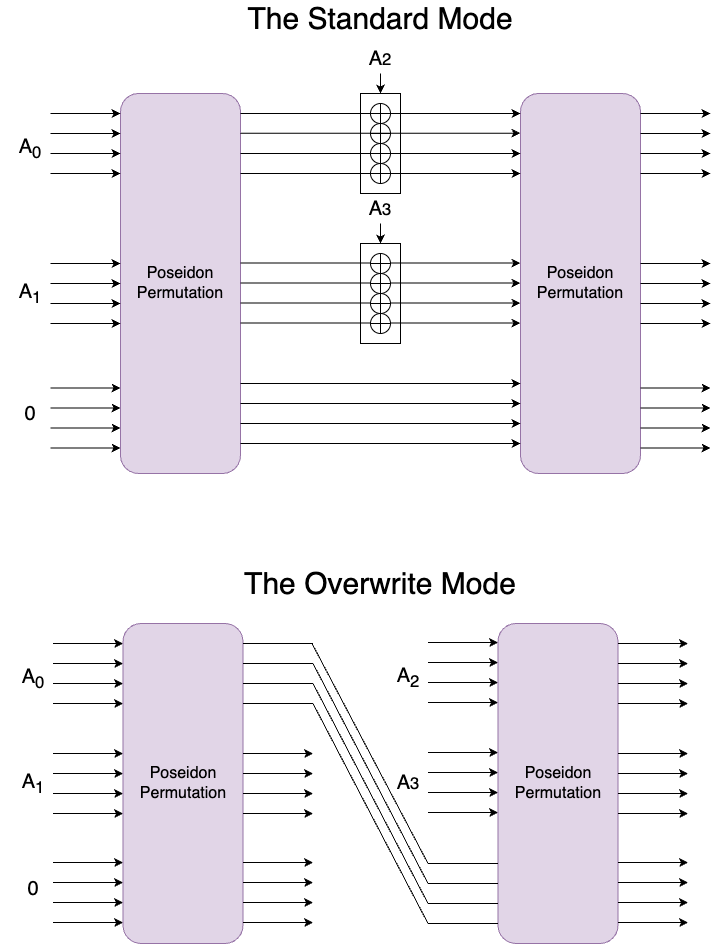

*By Héctor and Tomer. This note comes out of a discussion with Markus, Tomer, Al, and Jordi.*

## What others do

[Poseidon](https://eprint.iacr.org/2019/458.pdf) is a hash function instantiating a [sponge construction](https://en.wikipedia.org/wiki/Sponge_function) using the Poseidon$^\pi$ permutation. The standard way to use the sponge construction is to carry over the output of one permutation call as input to the next. A widely used optimization, sometimes known as *overwrite mode*, is to truncate the top part of the permutation and only carry over the lower part to the next call.

## What we do

In Polygon zkEVM, we are using a slightly modified version of this construction. The modification is in how we use the output of one permutation call as input to the next one. Rather than preserving the order of inputs between permutations, we carry over the four topmost elements of the last permutation output to be the bottom four elements of the next permutation’s input.

<!--
In Polygon zkEVM, we are substituting the standard mode of the Poseidon sponge/squeeze function, denote it $P : \mathbb{F}^{12} \to \mathbb{F}^{12}$, by the overwrite mode with $M \circ P$ being the "new" Poseidon permutation. Here, $\mathbb{F}$ is the [Goldilocks prime field](https://xn--2-umb.com/22/goldilocks/) and $M$ is the (bijective) linear map that "connects" the first four outputs (and therefore belonging to the rate part) of $P$ with the  capacity of the next absorbing phase. These first four outputs are those that we always squeeze out.
-->

## Where do we do It

1. **Linear Hashing**. Here we just need to squeeze out four output elements and therefore only one permutation call is made in the squeezing phase. Also, by continuosly linear hashing distinct leaf elements and hashing together the result of distinct levels we can build a Merkle tree.
1. **Fiat-Shamir'ing things**. In this scenario, we may need more than four output elements. To this end, we make as many permutation calls as necessary squeezing out four output elements each time until the desired number of outputs is achieved.

## Is it safe to do it?

Yes, assuming Poseidon$^\pi$ is a secure permutation. To see this, observe that the routing of output wires can be achieved by multiplying the output vector with a permutation matrix. Then, this permutation matrix can be absorbed into Poseidon$^\pi$’s last MDS matrix without affecting its cryptographic properties. Then, employing this new variant of Poseidon$^\pi$ in overwrite mode results in our construction.

<!--
Yes, assuming $P$ is a secure permutation. Since we take $P$ to be the Poseidon permutation and $M$ is a bijective linear map, the security arguments for $P$ also hold for the peremutation $M \circ P$. Precise details on security of the overwrite mode can be found in this [paper](https://keccak.team/files/CSF-0.1.pdf) from the Keccak team.
-->

Another approach to this question, providing a more general result, is to consider that if the four topmost elements can be distinguished from the bottom four elements it implies that they have different distributions; and therefore, at least one of these sets is not uniformly distributed. This in turn implies that the unmodified sponge function is insecure.
